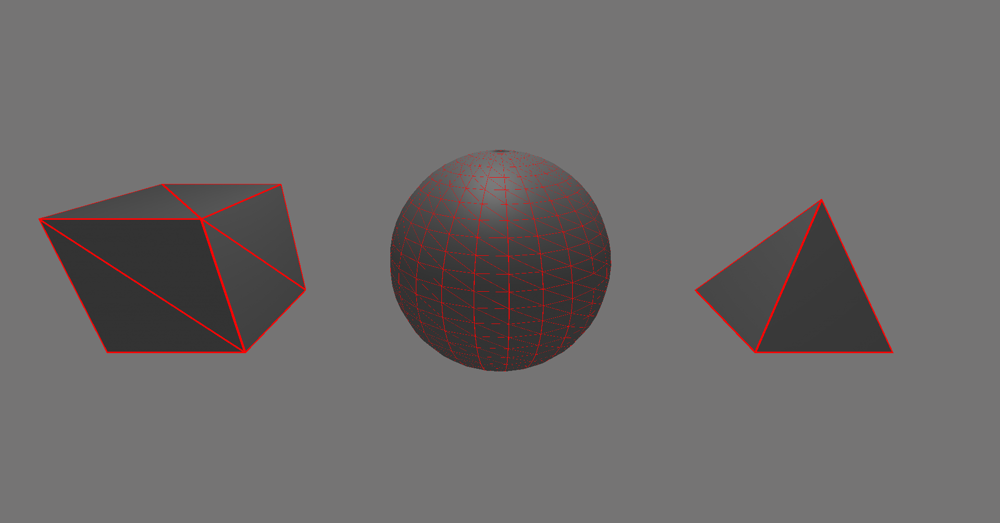
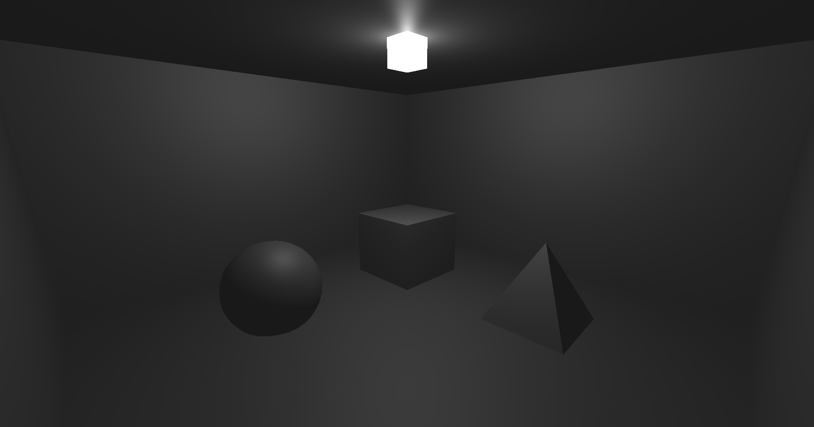
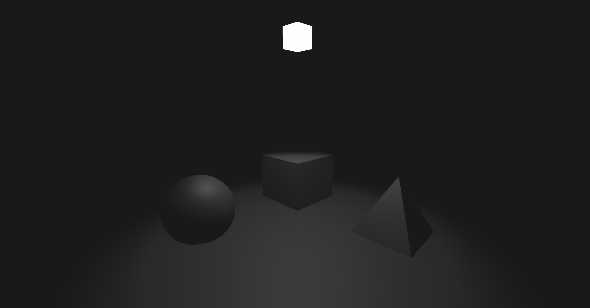

### **What is it?**
**VALDA** is a multi-threaded, tile-based CPU software rasterizer written in Java built from scratch without external graphics APIs. It provides custom math and rendering classes to transform 3D geometry, apply lighting values, sample textures, and render frames on screen.
  
### **Motive**
The VALDA engine grew out of hands-on studying in linear algebra, computer graphics, and system design-reasearching how mathematical transforms, clipping, and rasterizing can turn raw numbers into real-time rendered visuals. Working on this project bridged the gap between abstract math and low-level rendering behavior.
  

## Mesh Generation

VALDA is capable of generating various geometric shapes including cubes, pyramids, spheres, and custom polygons. The engine requires a list of vertices and applicable indices in order to render the mesh.

| Parameter | Shader | Wireframe |
| :--- | :---: | :---: |
| **Render** |  |  |

  
## Lighting

| Parameter | Point | Spot | Directional |
| :--- | :---: | :---: | :---:|
| **Render** |  |  |  |
| **Intensity** | 1 | 1 | 1 |
| **Linear** | 0.05 | 0.05 | - |
| **Quadratic** | 0.05 | 0.05 | - |
| **Inner Cutoff** | - | 0.8 | - |
| **Outer Cutoff** | - | 0.7 | - |
| **Yaw** | - | 0 | 0 |
| **Pitch** | - | 0 | -90 |

  
## Texture Sampling

VALDA utilizes UV texture mapping and barycentric coordinates to assign color to an interpolated pixel belonging to an entity. Images below use bilinear texture filtering.

| Parameter | With Lighting | No Lighting |
| :--- | :---: | :---: | 
| **Render** |  |  |

  

## Engine Architecture

  

  

## Memory Efficiency and Data Layout

To minimize garbage collector overhead, the engine uses flat primitive arrays and pre-allocated buffers: 

* **Contiguous Stride Buffers:** Vertex values are packed into flat double[] arrays to improve CPU cache locality and reduce cache misses (Example: INITIAL_MESH_STRIDE = 6 for [x, y, z, w, u, v], expanding to 12 values per vertex once normal and tangent vectors are baked in).

 

* **Global Scene Buffers and Offsets:** The Scene class packs entity geometry values into shared global arrays and assigns offsets to each Entity, avoiding repeated array allocations during rendering.

 

* **Tile Buffers:** The screen is divided into partitioned tiles, each owning its own colorBuffer and depthBuffer. Worker threads rasterize assigned tiles in parallel without sharing mutable pixel buffers.

  

**Specifications**: 
* Requires Java extension installation (such as VS Code Java extension).

 

**Complie Instructions**: 
* javac -d out src/*.java

 

**Run Instruction**: 
* java -cp out Main
