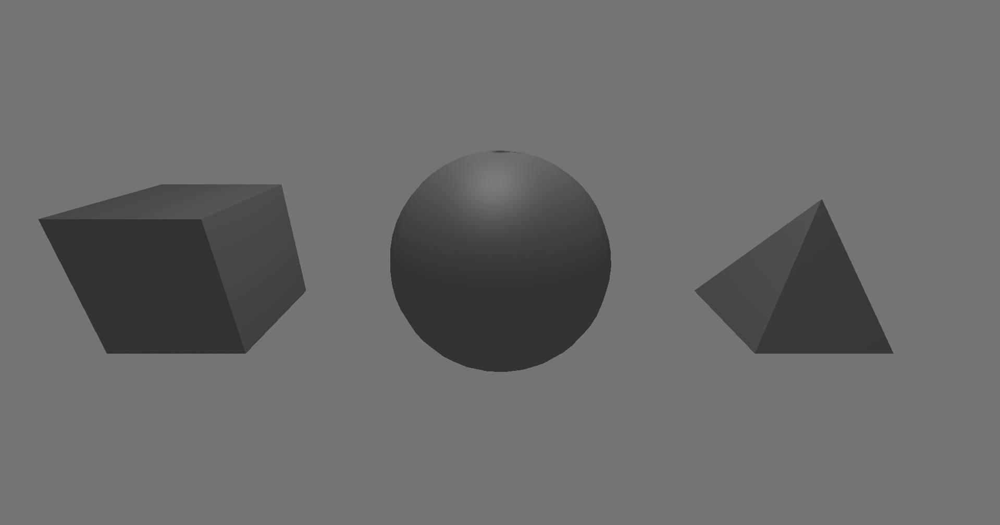
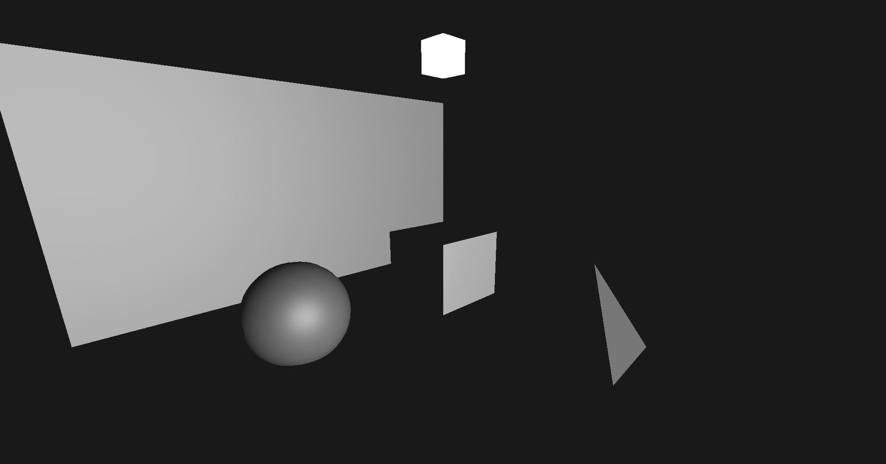
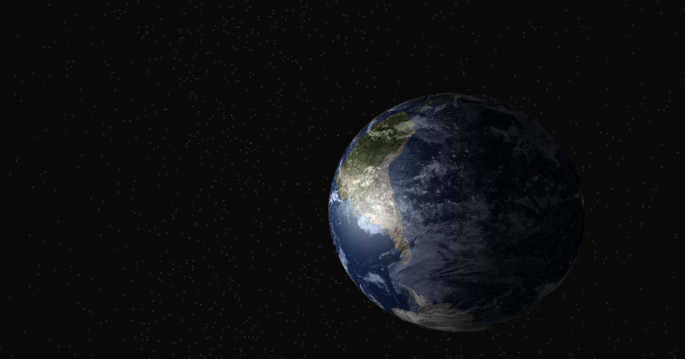
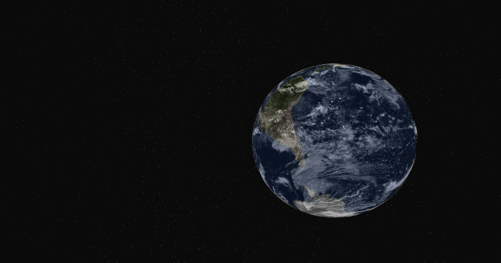

      **VALDA** is a multi-threaded, tile-based CPU software rasterizer written in Java built from scratch without external graphics APIs. It provides custom math and rendering classes to transform 3D geometry, apply lighting values, sample textures, and render frames on screen.
      **Motive**
      The VALDA engine grew out of hands-on studying in linear algebra, computer graphics, and system design-reasearching how mathematical transforms, clipping, and rasterizing can turn raw numbers into real-time rendered visuals. Working on this project bridged the gap between abstract math and low-level rendering behavior.

## Mesh Generation

VALDA is capable of generating various geometric shapes including cubes, pyramids, spheres, and custom polygons. The engine requires a list of vertices and applicable indices in order to render the mesh.

| Parameter | Shader | Wireframe |
| :--- | :---: | :---: |
| **Render** |  |  |

## Lighting

| Parameter | Point | Spot | Directional |
| :--- | :---: | :---: | :---:|
| **Render** |  |  |  |
| **Intensity** | 1 | 1 | 1 |
| **Linear** | 0.05 | 0.05 | - |
| **Quadratic** | 0.05 | 0.05 | - |
| **Inner Cutoff** | - | 0.8 | - |
| **Outer Cutoff** | - | 0.7 | - |
| **Yaw** | - | 0 | 0 |
| **Pitch** | - | 0 | -90 |

## Texture Sampling

     VALDA utilizes UV texture mapping and barycentric coordinates to assign color to an interpolated pixel belonging to an entity. Images below use bilinear texture filtering.

| Parameter | With Lighting | No Lighting |
| :--- | :---: | :---: | 
| **Render** |  |  |

      **Specifications**
      Reguires Java extension installation (such as VS Code Jva extension).

      **Complie Instruaction**
      javac -d out src/*.java

      **Run Instruction**
      java -cp out Main
